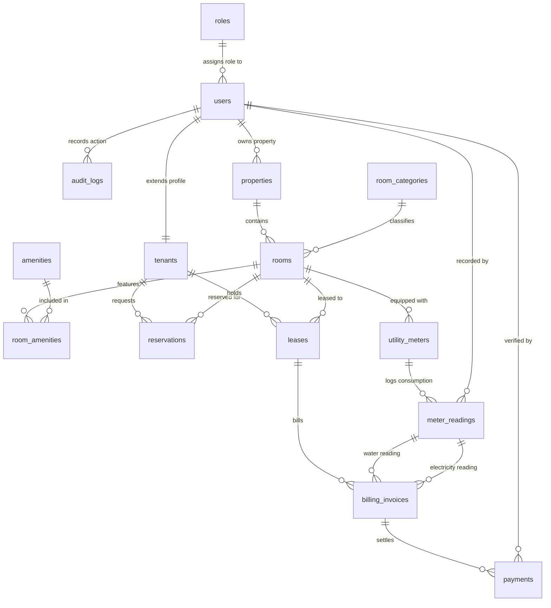

# DormEase: Integrated Student Boarding House Room Reservation and Utility Billing Management System

[](#)
[](#)
[](#)
[](#)
[-success.svg)](#)

---

## 1. System Short Description & Domain Value

**DormEase** is a web-based boarding house room reservation and utility billing management system built for student dormitory landlords, caretaking staff, and university boarders. Traditional student boarding houses suffer from manual logbooks, missed payment dates, and hostile disputes over shared electric and water bills. 

**Why It's Easy:** Landlords post available rooms with photos and amenities, onboard students into formal lease agreements, and log monthly sub-meter indices (water and electricity). DormEase autonomously calculates tiered consumption tariffs (baseline quotas vs. surge rates), generates itemized digital billing receipts combining rent and utilities, and tracks GCash/cash payment settlements with instant proof-of-payment receipts.

---

## 2. The 10 Primary Core Entities

While the complete database features **16 normalized relational tables** to meet the 6-member rubric requirement, the 10 central business entities are:

1. **`users`**: All system actors (Landlords, Caretakers, Student Tenants) with secure authentication, contact details, and account status.
2. **`roles`**: Role-Based Access Control (RBAC) definitions (`LANDLORD`, `STAFF`, `STUDENT_TENANT`).
3. **`properties`**: Physical boarding house branches or dormitory buildings with addresses and ownership links.
4. **`room_categories`**: Room accommodation classifications (e.g. Solo Deluxe, Twin Sharing, Quad Bedspace) with base pricing and occupancy limits.
5. **`rooms`**: Specific rentable units containing room numbers, floor levels, air conditioning fixtures, and real-time occupancy status (`AVAILABLE`, `OCCUPIED`, `MAINTENANCE`).
6. **`tenants`**: Extended student boarder profile linking university/company affiliation, student ID number, and emergency guardian contact details.
7. **`reservations`**: Prospective student booking requests, intended move-in dates, and initial advance deposits.
8. **`leases`**: The central binding tenancy contract specifying monthly rent amount, security deposit, move-in/out dates, and active occupancy status.
9. **`utility_meters` & `utility_rates`**: Sub-meter hardware registers linked to rooms, governed by tiered pricing brackets (Tier 1 baseline limit/rate vs. Tier 2 surge rates).
10. **`billing_invoices` & `payments`**: Autonomous billing entity calculating rent + water + electric + late penalties, and issuing official digital receipt numbers.

---

## 3. Entity-Relationship (ER) Architecture (16 Tables)



---

## 4. Ownership Matrix (6 members)

*Rubric 5.4: this table is the record of who owns what. Each member replaces the `@your-github-username` placeholder with their own GitHub username in their first pull request.*

| Member | GitHub username | Tables | Endpoints / screen | Join report(s) and join type | Feature role |
| :--- | :--- | :--- | :--- | :--- | :--- |
| 1 | @ejiejing000 | `roles`, `users` | `/api/users` (GET, POST, PUT, DELETE), `POST /api/users/login`, `GET /api/users/me` - screen `js/users.js` + login in `js/common.js` | `/api/users/reports/roles-inner-join` - INNER JOIN | Core: users, roles, login (401/403), database setup |
| 2 | @your-github-username | `properties`, `room_categories`, `rooms`, `amenities`, `room_amenities` | `/api/rooms` (GET, POST, PUT, DELETE) - screen `js/rooms.js` | `/api/rooms/reports/amenities-left-join` - LEFT JOIN | Master data: room catalog |
| 3 | @your-github-username | `tenants`, `leases` | `/api/leases` (GET, POST, PUT, DELETE) - screen `js/leases.js` | `/api/leases/reports/tenancy-inner-join` - INNER JOIN | Transactions: contracts |
| 4 | @your-github-username | `utility_meters`, `utility_rates`, `meter_readings` | `/api/readings` (GET, POST, PUT, DELETE), `simulate-tier-calculation` - screen `js/utilities.js` | `/api/readings/reports/consumption-inner-join` - INNER JOIN | Unique feature, part 1: tiered rate engine |
| 5 | @your-github-username | `billing_invoices`, `payments` | `/api/invoices` (GET, POST, PUT, DELETE), `POST /:id/pay` - screen `js/invoices.js` | `/api/invoices/reports/payments-left-join` - LEFT JOIN | Unique feature, part 2: invoices and receipts |
| 6 | @your-github-username | `reservations`, `audit_logs` | `/api/reports/reservations` (GET, POST, PUT, DELETE), `/api/reports/audit-logs`, `/api/reports/dashboard-stats` - screen `js/reports.js` (Reservations tab) | `/api/reports/full-outer-join` - FULL OUTER JOIN (LEFT JOIN UNION reverse) | Reports, reservations, audit log, dashboard |

Frontend: one plain script per member in `src/public/js/` (`common.js` is the shared helper file owned by Member 1).

### Login, 401 and 403
- `POST /api/users/login` (public) returns a signed token. Every other `/api` call needs `Authorization: Bearer <token>`, otherwise **401**.
- A logged-in user whose role may not do an action gets **403**. Roles: `LANDLORD` (everything), `STAFF` (rooms, leases, readings, invoices, reservations), `STUDENT_TENANT` (read only, can request a reservation).
- Passwords are stored as scrypt hashes; the code is in `src/middleware/auth.js` (Member 1). Each route file adds its own `authorize(...)` rules.
- Demo accounts (password `dormease123`): `roberto.landlord@dormease.ph` (landlord), `maria.caretaker@dormease.ph` (staff), `kenji.takahashi@univ.edu.ph` (tenant).

### Tests
- `npm test` - 12 unit checks (models + controllers + joins).
- `npm run test:api` - 30 checks over HTTP: login, 401, 403, CRUD, joins, 404.

All scripts share the same page, `src/public/index.html`.

---

## 5. The Domain Major Feature: Automated Tiered Utility & Receipt Engine

DormEase satisfies all four criteria of the **Major Feature Rubric**:
1. **Applies Complex Business Rules / Calculations**: Implements graduated tiered utility rates. Electricity consumption up to 80 kWh is charged at standard rate (₱12.50/kWh); consumption above 80 kWh triggers a surge rate (₱16.00/kWh). Water incorporates baseline quotas and surge rates.
2. **Autonomous System Behavior**: Upon logging a meter reading, the system automatically checks for rollback anomalies, computes the exact consumption bracket, consolidates monthly room rent with utility charges, and generates a digital billing statement.
3. **Demoable Edge Cases**:
   - *Case 1 (Standard):* 60 kWh -> 100% Tier 1.
   - *Case 2 (Surge):* 105 kWh -> 80 kWh Tier 1 + 25 kWh Tier 2 surge.
   - *Case 3 (Validation Edge Case):* Attempting to log a current reading lower than previous reading (`curr < prev`) immediately rejects with HTTP 400 Bad Request.
4. **Goes Beyond Generic CRUD**: Without this calculation engine, the application would simply be a generic room directory.

---

## 6. SQL Joins Technical Specification

### 1. INNER JOIN (Member A, C, D)
- **Member C Example**: Strictly matches active tenancy contracts with tenant profiles, rooms, and properties.
```sql
SELECT l.id AS lease_id, l.monthly_rent_amount, l.lease_start_date, l.lease_status,
       r.room_number, p.property_name, u.full_name AS tenant_name, t.student_id_number
FROM leases l
INNER JOIN tenants t ON l.tenant_id = t.id
INNER JOIN users u ON t.user_id = u.id
INNER JOIN rooms r ON l.room_id = r.id
INNER JOIN properties p ON r.property_id = p.id
ORDER BY l.lease_start_date DESC;
```

### 2. LEFT JOIN (Member B & E)
- **Member E Example**: Audits paid vs. unpaid billing invoices, preserving all invoices even if payment is `NULL`.
```sql
SELECT bi.id AS invoice_id, bi.invoice_number, bi.total_amount_due, bi.invoice_status,
       p.receipt_number, p.payment_amount, p.payment_method
FROM billing_invoices bi
LEFT JOIN payments p ON bi.id = p.invoice_id
ORDER BY bi.payment_due_date ASC;
```

### 3. FULL OUTER JOIN via UNION (Member F)
- **Member F Example**: Cross-domain reconciliation of occupied rooms, vacant rooms without leases (left-only), and unassigned lease contracts (right-only). Emulated via `UNION` of `LEFT JOIN` and inverted `LEFT JOIN` (Section 4 Rubric compliance for SQLite/MySQL).
```sql
SELECT r.id AS room_id, r.room_number, r.status AS room_status,
       l.id AS lease_id, l.lease_status, u.full_name AS tenant_name,
       CASE WHEN l.id IS NOT NULL THEN 'MATCHED: Occupied Room'
            ELSE 'LEFT-ONLY: Vacant Unleased Room' END AS audit_classification
FROM rooms r
LEFT JOIN room_categories c ON r.category_id = c.id
LEFT JOIN leases l ON r.id = l.room_id AND l.lease_status = 'ACTIVE'
LEFT JOIN tenants t ON l.tenant_id = t.id
LEFT JOIN users u ON t.user_id = u.id

UNION

SELECT r.id AS room_id, r.room_number, r.status AS room_status,
       l.id AS lease_id, l.lease_status, u.full_name AS tenant_name,
       'RIGHT-ONLY: Detached Contract / Unassigned Room' AS audit_classification
FROM leases l
LEFT JOIN rooms r ON l.room_id = r.id
LEFT JOIN room_categories c ON r.category_id = c.id
LEFT JOIN tenants t ON l.tenant_id = t.id
LEFT JOIN users u ON t.user_id = u.id
WHERE r.id IS NULL
ORDER BY room_number ASC;
```

---

## 7. Multi-Member GitHub Setup & Git Workflow

*This decides 90% of your individual grade. Follow these exact steps to prove individual Git history.*

### Step 1: Member A Creates the Main Repository
1. Member A goes to GitHub -> **New Repository** -> name it `dormease-system`.
2. Push the scaffold codebase to `main`:
   ```bash
   git init
   git add .
   git commit -m "feat: initial dormease mvc architecture and schema scaffold"
   git remote add origin https://github.com/<your-username>/dormease-system.git
   git branch -M main
   git push -u origin main
   ```
3. Member A enables Branch Protection on `main` (Settings -> Branches -> Add branch protection rule -> Require a pull request before merging).

### Step 2: Member A Adds Teammates as Collaborators
- Go to **Settings** -> **Collaborators** -> **Add people**.
- Add the GitHub usernames of Members B, C, D, E, and F.

### Step 3: Members Clone & Create Their Feature Branches
Each member clones the repository to their own computer:
```bash
git clone https://github.com/<your-username>/dormease-system.git
cd dormease-system
```
Configure your Git identity so your commits link to your own GitHub account:
```bash
git config user.name "Your Full Name"
git config user.email "your-github-registered-email@example.com"
```

Each member checks out their designated feature branch:
- **Member A**: `git checkout -b feature/memberA-core-auth`
- **Member B**: `git checkout -b feature/memberB-master-rooms`
- **Member C**: `git checkout -b feature/memberC-leases-contracts`
- **Member D**: `git checkout -b feature/memberD-utility-tier-engine`
- **Member E**: `git checkout -b feature/memberE-itemized-invoices`
- **Member F**: `git checkout -b feature/memberF-reports-full-outer`

### Step 4: Work in Your Own Slice & Commit Regularly
Commit frequently with semantic prefixes:
```bash
git add src/models/UtilityModel.js src/controllers/UtilityController.js
git commit -m "feat: add tiered rate computation logic in UtilityModel"
git push -u origin feature/memberD-utility-tier-engine
```

### Step 5: Pull Request and Merging (NEVER SQUASH)
1. Open a Pull Request on GitHub: `feature/your-branch` into `main`.
2. A teammate reviews and approves the PR.
3. **CRITICAL (Rubric Section 6):** Click the dropdown on the merge button and select **"Create a merge commit"**. 
   > **DO NOT select "Squash and merge"**. Squash merges collapse individual commits and erase grading evidence.

---

## 8. Installation & Setup Tutorial

### Prerequisites
- [Node.js](https://nodejs.org/) (**version 22.5 or newer** - the app uses the built-in `node:sqlite`)
- Git CLI

### Quick Start
```bash
# 1. Clone repository
git clone https://github.com/<your-username>/dormease-system.git
cd dormease-system

# 2. Install dependencies
npm install

# 3. Copy environment configuration
cp .env.example .env

# 4. Run automated test suite
npm test

# 5. Launch DormEase web application
npm start
```

Open your browser to: **`http://localhost:3000`**

---

## 9. Defense Day Preparation & Live Code Cheat Sheet

During defense, examiners test whether you wrote your code by asking for line-by-line explanations and requiring a small live code change on the spot.

### Member A (Core Slice)
- **Files Owned:** `UserModel.js`, `UserController.js`, `userRoutes.js`, `users.html`
- **Expected Defense Question:** *"How does your user deletion handle foreign keys?"*
- **Live Code Change Request:** *"Change the default status for newly registered users from ACTIVE to PENDING."*
  - **Where to change:** `src/models/UserModel.js` line 41 (`status = 'PENDING'`).

### Member B (Master Data)
- **Files Owned:** `RoomModel.js`, `RoomController.js`, `roomRoutes.js`, `rooms.html`
- **Expected Defense Question:** *"Why does your Amenities join use a LEFT JOIN instead of an INNER JOIN?"*
  - **Answer:** *"Because newly built rooms might not have amenities assigned yet. An INNER JOIN would hide unequipped rooms; LEFT JOIN keeps all rooms visible."*
- **Live Code Change Request:** *"Filter rooms by floor number."*

### Member C (Transactions)
- **Files Owned:** `LeaseModel.js`, `LeaseController.js`, `leaseRoutes.js`, `leases.html`
- **Expected Defense Question:** *"How do you prevent leasing a room that is already occupied?"*
  - **Answer:** *"In `LeaseController.create()`, we query `RoomModel.getById(room_id)` and check `if (room.status === 'OCCUPIED') return res.status(400)`."*
- **Live Code Change Request:** *"Enforce minimum security deposit equal to 2 months rent."*

### Member D (Unique Feature 1 - Calculation Engine)
- **Files Owned:** `UtilityModel.js`, `UtilityController.js`, `utilityRoutes.js`, `readings.html`
- **Expected Defense Question:** *"Walk me through the tiered electricity calculation for 105 kWh."*
  - **Answer:** *"Tier 1 limit is 80 kWh @ ₱12.50 = ₱1,000. Surge excess is 25 kWh @ ₱16.00 = ₱400. Base fee = ₱50. Total = ₱1,450.00."*
- **Live Code Change Request:** *"Adjust Tier 1 limit from 80 kWh to 100 kWh."*
  - **Where to change:** `src/models/UtilityModel.js` line 83 or in `utility_rates` table.

### Member E (Unique Feature 2 - Digital Receipts)
- **Files Owned:** `InvoiceModel.js`, `InvoiceController.js`, `invoiceRoutes.js`, `invoices.html`
- **Expected Defense Question:** *"What happens when a tenant pays an invoice?"*
  - **Answer:** *"We insert a record into `payments`, generate an official receipt number `RCPT-YYYYMM-XXXX`, and update `billing_invoices.invoice_status = 'PAID'`."*
- **Live Code Change Request:** *"Add a 5% late surcharge for overdue invoices."*

### Member F (Analytics & System Cohesion)
- **Files Owned:** `ReportModel.js`, `ReportController.js`, `reportRoutes.js`, `reports.html`
- **Expected Defense Question:** *"How does your emulated FULL OUTER JOIN work in SQLite?"*
  - **Answer:** *"SQLite does not support the FULL OUTER JOIN keyword natively. We take a LEFT JOIN between rooms and leases, and UNION it with an inverted LEFT JOIN where room ID is NULL. This returns occupied rooms, vacant rooms, and unassigned leases."*
