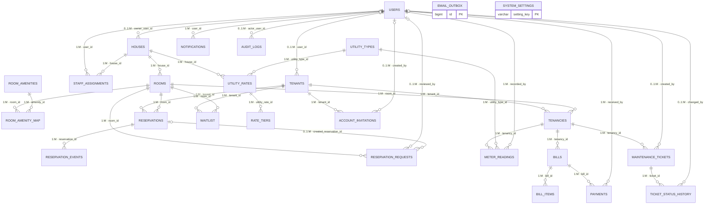

# DORMEASE

Student boarding-house management: public room browsing, guest reservation requests, tenant and
lease management, monthly utility billing with roommate splits, payments and receipts, maintenance
tickets, reports and an audit trail.

## Group roster

Fill in the registered names and GitHub usernames before the first push — the defense uses this
table to match commits to people.

| Member | Name | GitHub username | Branch | Feature area |
| --- | --- | --- | --- | --- |
| 1 | Ejie Mar Q. Bongcawel | ejiejing000 | `feature/00-core-auth` | Core platform, security, staff admin, public room discovery |
| 2 | Jiraiyah Ethan S. Beligolo | Furinaa1013 | `feature/10-properties` | Houses, rooms and amenities |
| 3 | Mark Andrian A. Bejar | markbejar1 | `feature/20-tenants-leases` | Tenants, leases, reservations, waitlist |
| 4 | Kim Abigail C. Bayot | abigeyl19 | `feature/30-utilities-billing` | Rates, readings, billing, payments |
| 5 | Jessa S. Boquecosa | LittleMiss10 | `feature/40-maintenance-comms` | Maintenance tickets and notifications |
| 6 | Aisha Janine L. Babor | Aiijan009 | `feature/50-onboarding-reports` | Reservation requests, invitation onboarding, settings |

## The three access areas

| Area | Who | What |
| --- | --- | --- |
| Public site | anyone, no login | Browse and filter listed rooms, read house and room details, submit a reservation request, track that request later with the email they used |
| Tenant portal | `tenant` | Their own lease, bills, payments and receipts, tickets, notifications |
| Management portal | `landlord` and `staff` | Requests, reservations, houses/rooms, tenants, leases, rates and readings, billing, payments, tickets, staff, reports, audit |

Nothing about a role can be chosen by the person logging in. `POST /api/auth/login` takes `email` and
`password` only; the role and the landing page come from the `users` row the token resolves to, and
the browser navigates to the `dashboard` value the server returned. There is **no registration
endpoint** — a tenant account exists only because staff approved a request and the tenant accepted a
single-use, expiring invitation link. Staff and landlord accounts are created by a landlord.

## Requirements

- Node.js 20+
- MySQL 8.0.16+ (the scripts use `CREATE OR REPLACE VIEW`, `information_schema` guards and `DELIMITER`)
- npm

## Quick start

```bash
# 1. configuration first, because the loader reads the database credentials from it
cp backend/.env.example backend/.env     # then set DB_PASSWORD and, for production, JWT_SECRET

# 2. database — either apply the member fragments in filename order
for file in database/schema/*.sql; do mysql -u root -p dormease < "$file"; done
for file in database/seed/*.sql;   do mysql -u root -p dormease < "$file"; done

#    ...or use the bundled loader, which needs no mysql client on PATH:
cd backend && npm install && npm run db:setup

# 3. run
npm start
```

`npm run db:setup` creates the database in `DB_NAME` and applies every file in `database/schema/`
then `database/seed/` in filename order through the app's own MySQL driver (it understands the
`DELIMITER` blocks). It is safe to re-run: existing tables are kept, columns added since an older
version of this schema are created, and views are replaced. `-- --db dormease_test` targets a
different database, and `-- --skip-seed` loads structure only. The files are split by member, so
each owner commits their own tables and seed data; `99_integration.sql` adds the cross-feature
foreign keys last.

Re-running covers *added* columns only. A database created before a primary key changed type (the
demo ids moved from `INT UNSIGNED` to `BIGINT UNSIGNED`) cannot be patched in place, because
`CREATE TABLE IF NOT EXISTS` leaves the old table alone and a new foreign key to it is rejected as
incompatible. The loader checks for that before running any statement and tells you so; rebuild with
`-- --fresh`, which drops the target database first and refuses to run under `NODE_ENV=production`.

One process serves everything: `npm start` listens on `http://localhost:9000`, hosts the API under
`/api` **and** serves `frontend/` as static files. There is no separate web server to configure.

| Open | URL |
| --- | --- |
| Public site | http://localhost:9000/ |
| Login | http://localhost:9000/pages/login.html |
| Health check | http://localhost:9000/health |
| API base | http://localhost:9000/api |

`npm run dev` does the same under nodemon.

## Demo accounts

`database/seed/00_core.sql` creates three accounts, all with the password **`DormEase#2026`**;
the other seed fragments add one demo row for each feature area:

| Email | Role | What it shows |
| --- | --- | --- |
| `landlord@example.com` | landlord | Full management portal, houses, staff, audit |
| `staff@example.com` | staff | Assigned to both demo houses; `can_manage_rates` is TRUE for house 1 and FALSE for house 2, so the per-assignment billing right is visible |
| `tenant@example.com` | tenant | Tenant portal with one active lease, bills and a ticket |

> **Never keep these accounts, or any seeded password hash, in a production database.** Do not load
> any file in `database/seed/` in production, and on any database that already has it, set
> `users.is_active = FALSE` for ids 1–3 and change each password with
> `node scripts/hash.js` plus `UPDATE users SET password_hash = ...`. The rows cannot simply be
> deleted — payments, readings and tickets reference those users with `RESTRICT`.
>
> ```bash
> cd backend && node scripts/hash.js "YourRealPassword"
> ```

## Configuration and secrets

`backend/.env` is read by `src/config/env.js` and is **not** in version control (`.gitignore` lists
it); `backend/.env.example` is the template. `DB_PASSWORD` is the only value the app cannot start
without. `JWT_SECRET` must be a long random string in production — the default in `.env.example` is a
placeholder, and the API is trivially forgeable if you leave it. Treat `.env` as a secret: never
commit it, never zip it into a handoff, and never paste its contents into an issue or chat.

## Tests

```bash
cd backend
npm test                      # 15 contract tests, no MySQL needed (the pool is stubbed)
TEST_DB=1 npm test            # the same 15 plus 2 end-to-end lifecycle tests = 17
```

The integration file writes rows, so point it at a throwaway database:

```bash
npm run db:setup -- --db dormease_test   # loads schema + views + seed there
TEST_DB=1 DB_NAME=dormease_test npm test
```

It is safe to re-run: each pass creates a fresh visitor, lease and bill, and if every seeded bed is
already taken by an earlier pass it provisions its own room through `POST /api/rooms` rather than
failing. Verified against MySQL 8.0.46 — `18 tests / 18 pass` on a seeded `dormease_test` and again
on a second consecutive run.

Three more scripts help when the code changes:

```bash
node backend/scripts/list-routes.js       # every mounted route, exactly as the server sees it
node backend/scripts/check-collection.js  # every URL in docs/dormease.postman_collection.json exists
node backend/scripts/check-schema.js      # expected columns + row counts, straight from information_schema
node backend/scripts/check-demo-login.js  # do the seeded accounts really accept DormEase#2026? (--fix resets)
```

## Layout

```
backend/          Express API, models, jobs, tests
  src/app.js      explicit route registry + static frontend
  src/routes/     one file per resource, each guarded by auth + requireRole
  src/controllers request validation and audit logging
  src/models      SQL only (pool, transactions, scope filters)
  src/jobs        hold expiry, overdue bills, ticket escalation, email outbox
  src/middleware  auth (role/scope), error handler
database/         schema/ and seed/ (one fragment per member), join_reports.sql, README.md
docs/             api-endpoints.md, erd.md, dormease.postman_collection.json
frontend/         public pages, css, js and pages/ for the signed-in portals
```

## Postman

Import `docs/dormease.postman_collection.json`. It carries the demo credentials as collection
variables, captures the token on login, and includes a **12 Security checks** folder that asserts the
rejections the UI cannot demonstrate (no token, `alg:none`, a tenant creating a room, a login body
trying to set `role: "landlord"`, probing a house you are not assigned to, `POST /api/auth/register`
returning 404).

## Business rules worth knowing

- `rooms.monthly_rent` is **per bed**, not per room. Rent is never split between roommates; only
  shared utilities are.
- Availability comes from `v_room_availability`: capacity minus active tenancies minus unexpired
  holds.
- **Billing starts when a lease is activated**, never when a request is submitted. A pending public
  request creates no tenant, no lease and no bill.
- Move-in months are prorated by occupied days; utilities use the tiered rate in
  `tiered_utility_cost()` and are divided among the roommates on the same active lease.
- Staff house scope is read from `staff_assignments` on **every** authenticated request, so removing
  an assignment takes effect immediately. `can_manage_rates` is checked per house, not per user.
- A resource outside your scope answers **404**, not 403, so ids cannot be probed. Hiding a button in
  the frontend is never the control — every rule above is enforced server-side.
- Invitation tokens are stored only as a sha256 hash, expire after `INVITATION_HOURS`, and are spent
  the first time they are accepted. No default password is ever emailed.
- Late fees and ticket escalation are guarded by database state (`late_fee_applied_at`,
  `escalated_at`), so the cron jobs are safe to re-run.

## Entity relationship diagram

26 tables, 35 foreign keys. Each label reads `parent:child` followed by the column on the child row:
`1:M` one-to-many, `0..1:M` a parent that may be absent, `1:1` one-to-one, `M:N` many-to-many. The
crow's foot at each end draws the same fact as a shape.



**The two many-to-many relationships.** There is no direct M:N foreign key; each is resolved by a
junction table, which is why it appears above as two `1:M` links.

| M:N pair | Junction table | Links |
| --- | --- | --- |
| users ↔ houses | `staff_assignments` | `staff_assignments.user_id`, `staff_assignments.house_id`; unique on the pair |
| rooms ↔ amenities | `room_amenity_map` | `room_amenity_map.room_id`, `room_amenity_map.amenity_id`; both are the primary key |

**The near one-to-ones.** `tenants.user_id` and `reservation_requests.created_reservation_id` are
nullable but written at most once by the application (invitation acceptance, request approval). The
schema does not put a unique key on either column, so the diagram says `0..1` rather than claiming a
`1:1` the database does not enforce.

Three things explain most of the shape:

- **`users` is not `tenants`.** A user row is an account (login, role); a tenant row is a person the
  house manages. `tenants.user_id` is nullable, so a tenant can hold a lease and be billed before they
  ever log in — that link is written only by the invitation flow, never by a public form.
- **A booking has two stages.** `reservation_requests` is the anonymous public ask; `reservations` is
  the staff-managed hold. Approving a request sets `reservation_requests.created_reservation_id` and
  optionally starts a `tenancies` row.
- **Billing hangs off the lease, not the person.** `bills` reference `tenancies`, so submitting a
  public request cannot produce a bill. `email_outbox` and `system_settings` have no foreign keys and
  are declared on their own.

Every column, primary key, unique key and enum value — plus the three views, the stored function and
both triggers — is in [`docs/erd.md`](docs/erd.md).

## Documentation

- [`docs/api-endpoints.md`](docs/api-endpoints.md) — every endpoint, who may call it, and its fields
- [`docs/erd.md`](docs/erd.md) — 26 tables, 3 views, the stored function and both triggers
- [`database/README.md`](database/README.md) — run order, idempotency and why each object exists
- [`frontend/pages/README.md`](frontend/pages/README.md) — page to API mapping and why there is no
  registration page

## Known limits

- Partial payments are supported per bill; allocating one payment across several bills is not.
- Email delivery stays in `email_outbox` unless `EMAIL_HOST` is configured in `backend/.env`.
- A deactivated staff account has no reactivation endpoint; set `users.is_active = TRUE` directly.
- Room photos are URLs, not uploads — there is no file-storage layer in this baseline.

## Six-member ownership matrix

The project is split into six mergeable slices. Member 1 owns the shared baseline and pushes it to
`main` first; every other member branches from that updated `main`, adds only their own files, and
opens a pull request. Merge with a merge commit (never squash), so each member's history stays
visible. No member commits another member's files.

| # | GitHub | Branch | Topic / feature | Tables owned | Schema + seed fragment | Complete CRUD resource | Join report endpoint | Frontend screens |
| --- | --- | --- | --- | --- | --- | --- | --- | --- |
| 1 | ejiejing000 | `feature/00-core-auth` | Core platform, security, staff administration, visitor room discovery | `users`, `staff_assignments`, `audit_logs` | `schema/01_core.sql`, `seed/00_core.sql`, `seed/15_staff.sql`, `schema/99_integration.sql` | Staff accounts: list, create, update, deactivate (`DELETE`) + auth session | `GET /api/staff/coverage` — LEFT JOIN users → assignments → houses | `login.html`, `dashboard.html`, `tenant-dashboard.html`, `staff.html`, `audit.html`, `reports.html`, public `index.html` / `browse-rooms.html` / `room-details.html` / `about.html` |
| 2 | Furinaa1013 | `feature/10-properties` | Houses, rooms and amenities | `houses`, `rooms`, `room_amenities`, `room_amenity_map` | `schema/02_properties.sql`, `seed/10_properties.sql` | Houses and rooms: list, get, create, update, delete (guarded) | `GET /api/rooms/vacancy-report` — RIGHT JOIN tenancies → rooms | `houses.html`, `rooms.html` |
| 3 | markbejar1 | `feature/20-tenants-leases` | Tenants, leases, reservations and waitlist | `tenants`, `tenancies`, `reservations`, `reservation_events`, `waitlist` | `schema/03_tenants_leases.sql`, `seed/20_tenants_leases.sql` | Tenants: list, get, create, update, delete (history-guarded) | `GET /api/tenancies/register` — INNER JOIN tenancies → tenants → rooms → houses | `tenants.html`, `lease.html`, `reservations.html` |
| 4 | abigeyl19 | `feature/30-utilities-billing` | Utility rates, meter readings, bills and payments | `utility_types`, `utility_rates`, `rate_tiers`, `meter_readings`, `bills`, `bill_items`, `payments` | `schema/04_billing.sql`, `seed/30_billing.sql` | Bills: list, get, generate/create, patch, void/delete | `GET /api/bills/ledger` — FULL OUTER JOIN bills ↔ payments (LEFT JOIN + RIGHT JOIN branch) | `rates.html`, `readings.html`, `bills.html`, `payments.html` |
| 5 | LittleMiss10 | `feature/40-maintenance-comms` | Maintenance tickets and notifications | `maintenance_tickets`, `ticket_status_history`, `notifications`, `email_outbox` | `schema/05_maintenance.sql`, `seed/40_maintenance.sql` | Tickets: list, get, create, update, status, delete | `GET /api/tickets/history-report` — LEFT JOIN tickets → status history | `tickets.html`, `notifications.html` |
| 6 | Aiijan009 | `feature/50-onboarding-reports` | Reservation requests, invitation onboarding | `reservation_requests`, `account_invitations` | `schema/06_onboarding.sql`, `seed/50_onboarding.sql` | Invitations: list, issue/create, revoke/update, delete + public accept | `GET /api/invitations/coverage` — LEFT JOIN tenants → invitations → users | `reservation-requests.html`, `invitations.html`, `set-password.html`, `request-status.html` |
