# DORMEASE — Entity Relationship Diagram

26 tables, 3 views, 1 stored function, 2 triggers. Generated from the member-owned fragments in
`database/schema/` (`01_core.sql` … `06_onboarding.sql`, plus `99_integration.sql`) — update this
file whenever a fragment changes.

## Reading the model

Three things explain most of the shape:

1. **`users` and `tenants` are separate.** A `users` row is an *account* (login + role). A `tenants`
   row is a *person the house manages*. `tenants.user_id` is nullable, so a tenant can exist, hold a
   lease and be billed long before they ever get login access. That link is written only by the
   invitation flow, never by a public form.
2. **A booking has two stages.** `reservation_requests` is the anonymous public ask; `reservations`
   is the staff-managed hold/approval. Approval of a request creates a reservation
   (`reservation_requests.created_reservation_id`) and, optionally, a `tenancies` row.
3. **Billing hangs off the lease, not the person.** `bills` references `tenancies`, so a bill can only
   exist once a tenancy is active — submitting a public request cannot produce a bill.

## Diagram

```mermaid
erDiagram
  USERS ||--o{ STAFF_ASSIGNMENTS : "staff scope"
  HOUSES ||--o{ STAFF_ASSIGNMENTS : "assigned house"
  USERS ||--o{ HOUSES : "owns (nullable)"
  HOUSES ||--o{ ROOMS : "contains"
  ROOMS ||--o{ ROOM_AMENITY_MAP : "has"
  ROOM_AMENITIES ||--o{ ROOM_AMENITY_MAP : "tagged by"
  HOUSES ||--o{ UTILITY_RATES : "prices"
  UTILITY_TYPES ||--o{ UTILITY_RATES : "priced as"
  UTILITY_RATES ||--o{ RATE_TIERS : "tiered by"

  USERS ||--o| TENANTS : "logs in as (nullable)"
  TENANTS ||--o{ TENANCIES : "signs"
  ROOMS ||--o{ TENANCIES : "hosts"
  TENANTS ||--o{ RESERVATIONS : "makes"
  ROOMS ||--o{ RESERVATIONS : "reserved in"
  RESERVATIONS ||--o{ RESERVATION_EVENTS : "audited by"
  ROOMS ||--o{ RESERVATION_REQUESTS : "asked for"
  USERS ||--o{ RESERVATION_REQUESTS : "reviews"
  RESERVATIONS ||--o| RESERVATION_REQUESTS : "created from"
  TENANTS ||--o{ WAITLIST : "queued for"
  ROOMS ||--o{ WAITLIST : "waited on"

  TENANCIES ||--o{ BILLS : "billed"
  BILLS ||--o{ BILL_ITEMS : "itemised"
  BILLS ||--o{ PAYMENTS : "settled by"
  USERS ||--o{ PAYMENTS : "receives"
  TENANCIES ||--o{ METER_READINGS : "consumes"
  UTILITY_TYPES ||--o{ METER_READINGS : "of"
  USERS ||--o{ METER_READINGS : "records"

  TENANTS ||--o{ ACCOUNT_INVITATIONS : "invited"
  USERS ||--o{ ACCOUNT_INVITATIONS : "sends"
  USERS ||--o{ NOTIFICATIONS : "receives"
  TENANCIES ||--o{ MAINTENANCE_TICKETS : "reports"
  USERS ||--o{ MAINTENANCE_TICKETS : "creates"
  MAINTENANCE_TICKETS ||--o{ TICKET_STATUS_HISTORY : "transitions"
  USERS ||--o{ TICKET_STATUS_HISTORY : "changes"
  USERS ||--o{ AUDIT_LOGS : "acts in"

  users {
    bigint id PK
    varchar full_name
    varchar email UK
    varchar password_hash "bcrypt cost 12; never serialised"
    enum role "landlord | staff | tenant — server-assigned only"
    boolean is_active "false = token invalid from the next request"
    timestamp created_at
  }

  houses {
    bigint id PK
    varchar name
    varchar address
    text description
    bigint owner_user_id FK "nullable; ON DELETE SET NULL"
    boolean is_active "false hides every room from the public site"
    timestamp created_at
  }

  staff_assignments {
    bigint id PK
    bigint user_id FK
    bigint house_id FK
    boolean can_manage_rates "per-house, not per-user"
  }

  rooms {
    bigint id PK
    bigint house_id FK
    varchar room_number "unique with house_id"
    decimal monthly_rent "per bed, not per room"
    int bed_capacity
    enum cooling_type "fan | aircon | none"
    boolean storage_available
    json amenities
    varchar photo_url
    boolean is_listed "false hides from v_public_rooms"
  }

  room_amenities {
    bigint id PK
    varchar name UK
  }

  room_amenity_map {
    bigint room_id PK "also FK"
    bigint amenity_id PK "also FK"
  }

  utility_types {
    bigint id PK
    varchar code UK "WATER, POWER (seed defines POWER, not ELECTRICITY)"
    varchar name
  }

  utility_rates {
    bigint id PK
    bigint house_id FK
    bigint utility_type_id FK
    decimal fixed_charge
    date effective_from "latest row on/before the billing month wins"
  }

  rate_tiers {
    bigint id PK
    bigint utility_rate_id FK
    decimal lower_units
    decimal upper_units "NULL = open-ended top tier"
    decimal price_per_unit
  }

  tenants {
    bigint id PK
    bigint user_id FK "nullable; set only by the invitation flow"
    varchar full_name
    varchar email
    varchar phone
    timestamp created_at
  }

  reservation_requests {
    bigint id PK
    bigint room_id FK
    varchar full_name "public input, not an account"
    varchar email "used to look up own status"
    varchar phone
    date preferred_move_in_date
    text message
    enum status "pending | approved | rejected | withdrawn"
    bigint reviewed_by FK
    datetime reviewed_at
    varchar review_note
    bigint created_reservation_id FK "nullable; set on approval"
    timestamp created_at
  }

  reservations {
    bigint id PK
    bigint tenant_id FK
    bigint room_id FK
    date start_date
    enum status "held | pending | approved | rejected | expired | cancelled"
    enum source "guest_request | staff_created"
    datetime hold_expires_at "counts against availability while future"
    timestamp created_at
  }

  reservation_events {
    bigint id PK
    bigint reservation_id FK
    varchar event_type
    varchar note
    timestamp created_at
  }

  waitlist {
    bigint id PK
    bigint tenant_id FK
    bigint room_id FK
    enum status "waiting | notified | fulfilled | cancelled"
    timestamp created_at
  }

  tenancies {
    bigint id PK
    bigint tenant_id FK
    bigint room_id FK
    date start_date
    date end_date "NULL = ongoing"
    enum status "active | ended"
    int occupants "drives the roommate utility split"
    timestamp created_at
  }

  meter_readings {
    bigint id PK
    bigint tenancy_id FK
    bigint utility_type_id FK
    date reading_period
    decimal previous_reading
    decimal current_reading "units = current - previous"
    bigint recorded_by FK
  }

  bills {
    bigint id PK
    bigint tenancy_id FK
    date billing_month "first day of the month"
    decimal rent_amount
    decimal water_amount
    decimal electricity_amount
    decimal late_fee
    decimal total_amount
    date due_date
    enum status "unpaid | partial | paid | overdue | void"
    datetime late_fee_applied_at "guard against a double late fee"
    timestamp created_at
  }

  bill_items {
    bigint id PK
    bigint bill_id FK
    varchar description
    decimal quantity
    decimal unit_price
    decimal amount "rent, each utility tier, the late fee"
  }

  payments {
    bigint id PK
    bigint bill_id FK
    decimal amount "rejects more than the outstanding balance"
    enum method "cash | bank_transfer | e_wallet | other"
    varchar reference_no
    bigint received_by FK
    datetime paid_at
  }

  account_invitations {
    bigint id PK
    bigint tenant_id FK
    varchar email
    char token_hash "sha256 of the emailed token; the token itself is never stored"
    datetime expires_at
    datetime accepted_at "non-null = single use already spent"
    bigint created_by FK
    timestamp created_at
  }

  notifications {
    bigint id PK
    bigint user_id FK
    varchar title
    text message
    enum channel "in_app | email"
    boolean is_read
    timestamp created_at
  }

  maintenance_tickets {
    bigint id PK
    bigint tenancy_id FK
    varchar title
    text description
    enum priority "low | normal | high | urgent"
    enum status "open | in_progress | resolved | closed | escalated"
    bigint created_by FK "who raised it — tenant or staff"
    datetime created_at
    datetime updated_at
    datetime escalated_at "set once by trg_ticket_escalation_once"
  }

  ticket_status_history {
    bigint id PK
    bigint ticket_id FK
    varchar status
    bigint changed_by FK
    varchar note
    timestamp created_at
  }

  audit_logs {
    bigint id PK
    bigint actor_user_id FK "NULL for system jobs"
    varchar action "e.g. reservation_request.approve"
    varchar entity_type
    bigint entity_id
    json details
    timestamp created_at
  }

  email_outbox {
    bigint id PK
    varchar recipient
    varchar subject
    text body
    enum status "queued | sent | failed"
    timestamp created_at
  }

  system_settings {
    varchar setting_key PK
    varchar setting_value
  }
```

## Views, function and triggers (member schema fragments)

| Object | Kind | Purpose |
| --- | --- | --- |
| `v_public_rooms` | view | The **only** source for `GET /api/public/rooms`. Projection of listed rooms in active houses: room number, rent, capacity, cooling, storage, amenities, photo, house name/address, `available_beds`, `is_available`. It has no tenant, billing or internal column, so the public API physically cannot leak one. |
| `v_room_availability` | view | `bed_capacity` − active tenancies − unexpired `held` reservations. Used for the availability badge and for overbooking checks. |
| `v_staff_house_scope` | view | `user_id, house_id, can_manage_rates`. Re-read on **every** authenticated request, so revoking an assignment takes effect immediately. |
| `tiered_utility_cost(rate_id, units)` | function | Walks `rate_tiers` in order and charges each band separately; `upper_units IS NULL` is the open top band. Keeps the tier maths in SQL so preview and generation cannot drift apart. |
| `trg_ticket_escalation_once` | trigger (BEFORE UPDATE) | Stamps `escalated_at` only on the first transition to `escalated`, so the SLA job cannot re-escalate. |
| `trg_ticket_history_on_insert` | trigger (AFTER INSERT) | Writes the initial `ticket_status_history` row, so no ticket exists without a first entry. |

## Join practice

`database/join_reports.sql` is a read-only teaching file — plain `SELECT`s over the tables above, no
writes and nothing the API depends on. It demonstrates the five joins this schema actually needs:
active lease with tenant and room (INNER), rooms including empty ones (LEFT, with `status='active'`
in the ON clause so the outer join is not silently turned into an inner one), income with house
details (RIGHT), leases missing a reading for a period (anti-join on `mr.id IS NULL`), and the
UNION that stands in for the FULL OUTER JOIN MySQL does not have.

## Conventions worth knowing

- All primary keys are `BIGINT UNSIGNED AUTO_INCREMENT`; every FK is declared inline except
  `fk_staff_house`, which is added by `99_integration.sql` after Member 2's `houses` table exists.
  Every cross-feature constraint is wrapped in `information_schema` guards, so a partial branch and
  a re-run are both safe.
- `bill_items.bill_id`, `rate_tiers.utility_rate_id`, `staff_assignments.*`, `room_amenity_map.*`,
  `reservation_events.reservation_id`, `account_invitations.tenant_id` and
  `ticket_status_history.ticket_id` use `ON DELETE CASCADE`; anything that would orphan a financial
  row uses `RESTRICT` (the default) instead.
- `uq_bill (tenancy_id, billing_month)` is what makes the monthly billing job idempotent.
- `uq_reading (tenancy_id, utility_type_id, reading_period)` stops a double-recorded meter reading.
